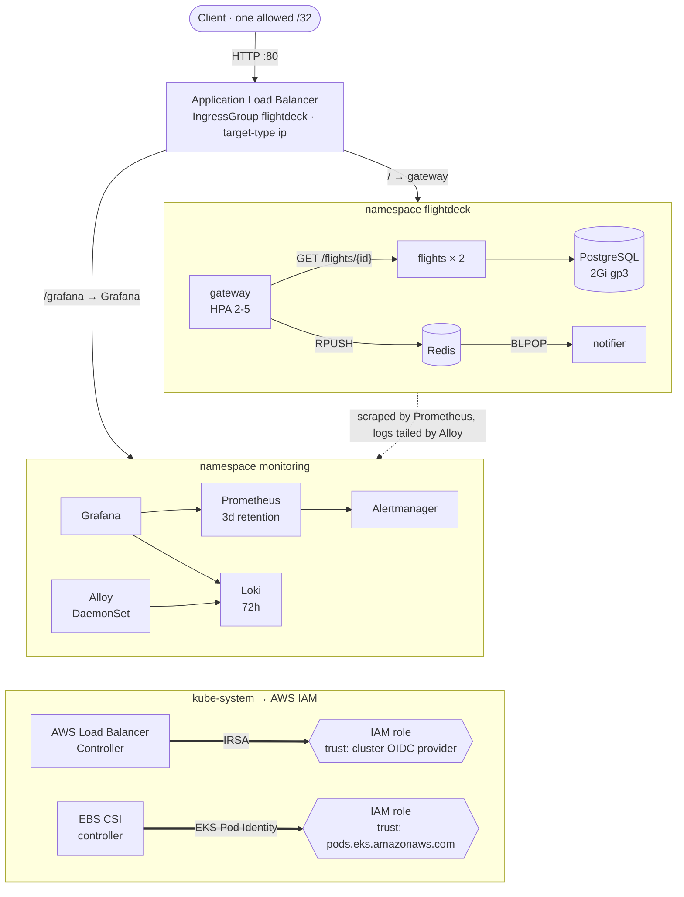
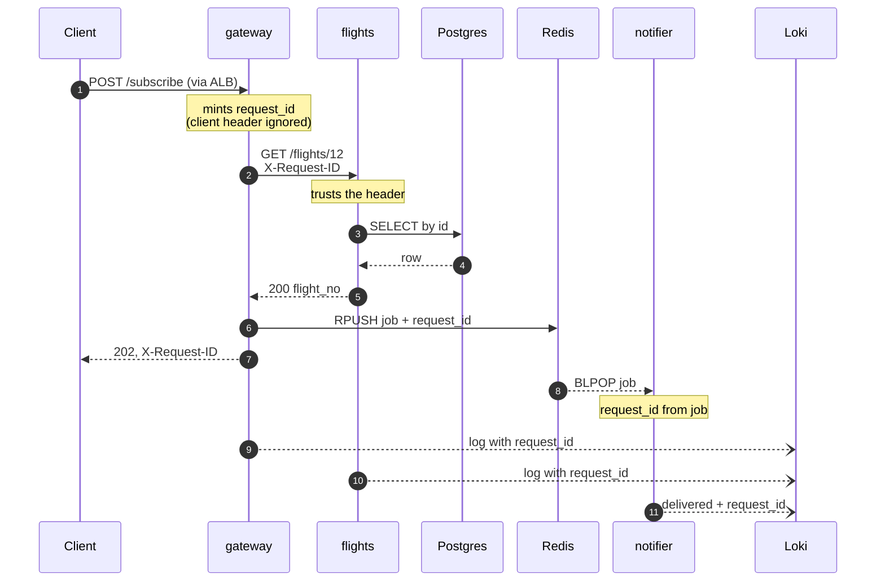
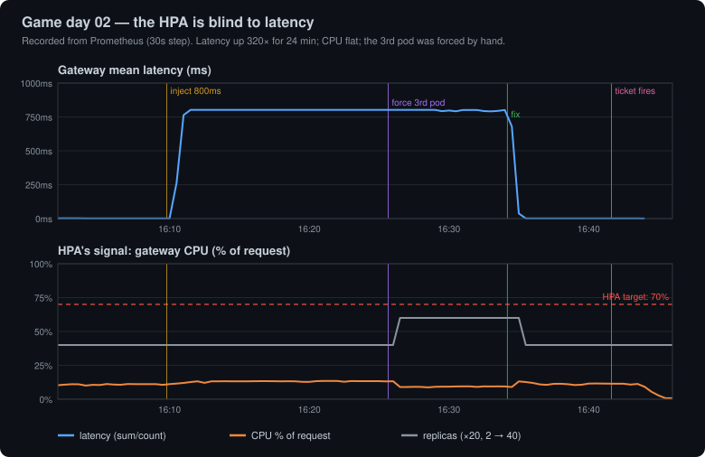
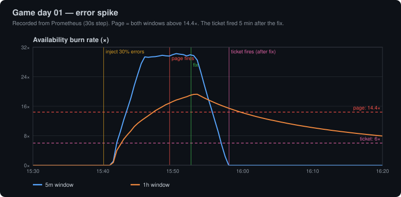
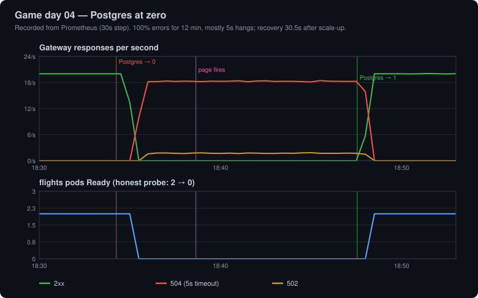
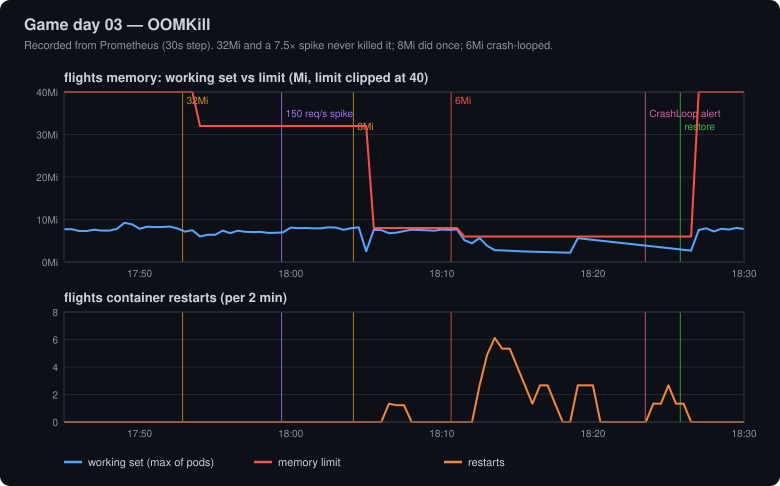

# flightdeck

**Three Go microservices for a flight-status API, run on Amazon EKS with the observability an SRE team would expect: SLOs with multi-window burn-rate alerts, RED dashboards, structured logs traced by request ID, and fault-injection game days written up honestly.**
Everything is code: one Helm chart for the app, committed values for every upstream chart, IAM policies as JSON, dashboards and alert rules in Git, and a `make` target for each step.
It was built, operated through four game days and torn down on a two-node cluster (2 × m7i-flex.large) over about 26 hours. **Usage came to ≈ $8.30**, all covered by account credits ([Cost](#cost)).

> **Status:** the cluster was deleted on 2026-10-19 and a sweep confirmed no AWS resources remain ([teardown](docs/teardown.md)). The repo is the deliverable. [`infra/cluster.yaml`](infra/cluster.yaml) and the [Quickstart](#quickstart) rebuild everything from an empty account.

**Site:** <https://saicharanchanda.github.io/flightdeck/> · **Game days:** [01 errors](docs/gameday-01-error-spike.md), [02 latency](docs/gameday-02-latency.md), [03 OOMKill](docs/gameday-03-oom.md), [04 Postgres down](docs/gameday-04-dependency.md) · **Teardown:** [docs/teardown.md](docs/teardown.md) · **Journal:** [docs/journal.md](docs/journal.md)

> **Headline finding:** under a 320× latency regression the gateway's
> CPU-based autoscaler didn't just fail to scale out — by its own arithmetic
> it wanted to scale **in**. [Details below](#incidents).

---

## Architecture

EKS `eks-practice` (Kubernetes 1.36) ran on 2 × m7i-flex.large in us-east-1: default VPC, public subnets, no NAT gateway. Images come from GHCR, tagged by git SHA.



Two identity mechanisms are in use **on purpose**: the AWS Load Balancer Controller assumes its role through **IRSA** (federated trust on the cluster's OIDC provider, scoped by a `sub` condition to one ServiceAccount); the EBS CSI driver uses **EKS Pod Identity** (trust on a single service principal, binding held in an EKS association). The differences are written up in [docs/identity.md](docs/identity.md).

### One request, end to end



`request_id` is a **structured-metadata field in Loki, not a label** (one stream per request would destroy the index). Grafana's Loki datasource turns it into a link: one click shows that request's lines from all three services.

---

## Incidents

Game days run with a k6 load generator inside the cluster (`make load`, 20 req/s, 70% lookups / 20% boards / 10% subscribes). Each writeup has a written-down prediction, a timestamped timeline, every PromQL and LogQL query used, and a section on what didn't go as expected. The charts below are rendered from the metrics Prometheus recorded during each run (`scripts/render-gameday-charts.ps1`).

A pattern across all four: **SLO alerts arrive late.** Their long windows are diluted by the clean traffic before each fault: in three of four runs an SLO alert fired only *after* the fix (the ticket in 01 and 02, the page in 03), and in 02 the page never fired at all. Where a cause-specific alert existed (03's crash loop) it fired first; where none existed (04's Postgres) nothing pointed at the cause.

### 02 — Latency injection: the autoscaler wanted to scale *in* ⭐

800ms injected into every gateway request for 24 minutes. Latency rose **320×**; the HPA's CPU signal went from **12% → 15%** of a 70% target and replicas stayed at 2. Its status read `ScalingLimited: TooFewReplicas — the desired replica count is less than the minimum`: a waiting goroutine uses no CPU, so by CPU arithmetic the gateway looked *over*-provisioned. A forced extra pod then received **0%** of in-cluster traffic, because a ClusterIP Service balances connections, not requests, and k6 keeps its connections open; the ALB, balancing per request, sent it 30%. The latency page never fired: with a 5% budget the burn rate tops out at 20×, so a total latency outage needs ~43 minutes to page.



→ [docs/gameday-02-latency.md](docs/gameday-02-latency.md) — predictions vs outcomes, why CPU autoscaling is blind to latency, what to scale on instead (in-flight requests via KEDA or prometheus-adapter), and what per-pod state means for a horizontally scaled service.

### 01 — Error spike: the page took 9.5 minutes; in production it would take ~29

30% of gateway requests returned 500. The fast-burn page fired 9m26s after injection; diagnosis took minutes because every error carried `route="unmatched"` and finished in 25µs without reaching flights. The fast detection was luck: the 1h window held only 6 minutes of clean traffic. With a full clean hour, a 30% error rate crosses the 14.4× threshold after ~29 minutes. The slow-burn ticket fired **5 minutes after the fix**. The alert's own description turned out to be wrong; it was fixed during the run.



→ [docs/gameday-01-error-spike.md](docs/gameday-01-error-spike.md)

### 04 — Postgres at zero: an honest readiness probe, and clients still hung for 5s

Postgres scaled to 0 for 13 minutes. flights' `/readyz` really does ping the database, and both replicas went NotReady within 49s — which emptied the Service, because the dependency is shared. **100% of API requests failed for 12 minutes, almost all by hanging for the gateway's full 5-second timeout** (504), not failing fast. flights had no DB timeout of its own, so its handlers queued for a pool connection until the *caller* gave up (goroutines 11 → 138; gateway 20 → 432). Every alert that fired named the gateway or flights; **none named Postgres**. Recovery took 30.5s from scale-up, with no restarts. One part — why the gateway kept hanging after flights left the Service — is left as an open question with a test plan.



→ [docs/gameday-04-dependency.md](docs/gameday-04-dependency.md) — readiness semantics for shared dependencies, a timeout budget, circuit breaking, and the alert that should have said "PostgreSQL is down".

### 03 — OOMKill: Go ignores the cgroup limit, and `GOMEMLIMIT` turned 12 restarts into 0

`go_gc_gomemlimit_bytes` read **`math.MaxInt64`**: without `GOMEMLIMIT`, Go's GC has no idea it's in a container. At 32Mi that didn't matter — flights sits at ~8Mi, **flat even at 7.5× traffic**. At 6Mi it crash-looped within a minute (back-off doubling to the 5-minute cap; `FlightdeckPodCrashLooping` fired 10 minutes in, before the SLO page; the gateway hung for 5s on most requests). Then the A/B: **the same 6Mi limit with `GOMEMLIMIT` ran 10 minutes with 0 restarts, against 12 without.** The "~8Mi floor" was mostly heap the unaware GC chose to keep; told the limit, it held the heap at 1.4Mi — at the price of ~17× the CPU on the busier pod and 2× latency. The chart now sets `GOMEMLIMIT` to 90% of every limit. (My first version of this writeup said the unaware GC *wasn't* the killer; the A/B proved it was — the correction is dated in the doc.)



→ [docs/gameday-03-oom.md](docs/gameday-03-oom.md) — also explains the notifier's 13:49 "restart" (a rolling replacement, clean exit, not an OOM) before the fault was injected.

---

## Engineering notes

Bugs found by operating the system, not by reading it. Each is fixed, or documented where the fix is a design change.

- **The Go runtime doesn't read the container's memory limit.** `go_gc_gomemlimit_bytes` = `math.MaxInt64` in every pod: the GC paced on `GOGC=100` with no idea a 6Mi limit existed. The chart now derives `GOMEMLIMIT` = 90% of each container's limit at render time (`goMemLimit.percent`), verified in the runtime afterwards (120795955 for 128Mi). In game day 03's A/B at a 6Mi limit it took restarts from 12 to 0. Its failure mode changes too: a Go service pinned at its limit no longer dies, it burns CPU on GC — so GC rate becomes the early warning.
- **An honest readiness probe on a shared dependency empties the Service.** flights' `/readyz` checks Postgres, correctly; when Postgres died every replica failed it at once, so clients lost flights' precise 503 and got the gateway's generic 504 instead. Readiness should mean "this pod can serve and another couldn't"; shared-dependency failure should be a fast 503 from a Ready pod.
- **No timeout means the caller's timeout.** flights' DB calls inherited the gateway's 5s context, so a dead database turned into 5s queues inside flights and hundreds of parked goroutines in the gateway. Each hop needs its own budget (500ms for a 1ms lookup).
- **`route="unmatched"` hides middleware failures.** The access-log/metrics middleware reads chi's route pattern *after* the handler runs. Chaos (and any middleware that rejects early) answers before routing, so those requests carry no route. During game day 01 that was a useful clue; in a real incident an auth or rate-limit rejection would be just as anonymous in the RED-by-route view. Fix: middleware that writes a 5xx should log a `reason`.
- **`$value` lies in multi-condition alerts.** In `A and B`, Prometheus returns **A's** value. The fast-burn alert said "17.67x burn over 5m" when it was the 1h window (the 5m burn was ~30×), and "budget gone in ~12h" was only true at exactly 14.4×. The descriptions now name the long window and compute time-to-exhaustion with a template query (`604800 / burnrate1h`): "gone in 16h 15m".
- **PowerShell 5.1 `ConvertFrom-Json` emits a JSON array as one object.** `close-consoles.ps1` wrapped it in `@(...)`, got an array containing the array, and ran its loop once with every PID — a malformed CIM filter error, masked by a fallback that killed the processes anyway. Fixed by assigning to a variable first; a synthetic test went from 1 iteration to 3.
- **Label collision with the Prometheus Operator.** Our metrics carry `service="gateway"`; the operator adds a target label `service=<k8s Service>`. Prometheus kept the target's value and renamed ours `exported_service`. Fixed with `honorLabels: true` on the ServiceMonitors.
- **Coarse histograms mislead.** With all requests at ~805ms, `histogram_quantile` reported p50 0.75s and p99 0.995s — the midpoint and edge of the `0.5–1.0s` bucket. `sum/count` and Loki's `unwrap duration_ms` gave the truth. There is also no 300ms bucket, so the "95% under 300ms" SLO is measured at 250ms.
- **An IngressGroup's security group is the union of its members.** Joining Grafana to the gateway's ALB meant every member must carry `inbound-cidrs`; one without it defaults to `0.0.0.0/0` and opens the whole ALB. Both Ingresses now require it, and the chart refuses to render without it.
- **Sizing from guesses fails; sizing from usage works.** Grafana's sidecars were OOMKilled at 96Mi, then Grafana itself at 384Mi; it idles at ~360Mi. Requests are now set to observed usage with ~2× headroom on limits.
- **A stopped clock service looked like bad credentials.** On teardown day every AWS call failed with `InvalidSignatureException` / `SignatureExpired`, while `kubectl` still worked. The workstation was 604s behind: Windows Time (`w32time`) was stopped, and SigV4 rejects signatures more than 300s off. Setting the time by hand didn't help (NTP looked blocked); starting the service did. Now the first check for a signing error is `w32tm /query /status`, before touching keys. ([docs/teardown.md](docs/teardown.md))
- **`helm uninstall` isn't teardown.** StatefulSet PVCs (Postgres, Redis, Prometheus) outlived their releases, and so would their EBS volumes have, once the CSI driver was gone. Grafana's and Loki's didn't: each chart decides. And the ALB belongs to the controller, not to EKS, so deleting the cluster first would have stranded it. Teardown order is in [docs/teardown.md](docs/teardown.md).
- **Docker Hub's `bitnami/*` only publishes `latest` now.** The no-`latest` rule is kept by pinning the Postgres and Redis images by digest.

---

## What I'd change at production scale

| Today | Why it's fine here | What I'd do |
|---|---|---|
| **Single-replica Postgres and Redis** on one EBS volume each, both in us-east-1d | Demo data, reseeded on deploy | Amazon RDS Multi-AZ (or CloudNativePG with replicas across AZs) and ElastiCache with a replica; app pods spread across ≥ 2 AZs with `topologySpreadConstraints` set to `DoNotSchedule` |
| **No backups** | Nothing to lose | RDS automated backups + PITR; Velero for cluster state and PVC snapshots; a restore drill as a game day |
| **Prometheus 3d retention**, local volume; the "7d" SLO window only sees 3 days | Fits a 10Gi volume and the node budget | Remote-write to Thanos/Mimir or Amazon Managed Prometheus; ≥ 30d for SLO windows, longer downsampled |
| **CPU-only HPA** | Proved inadequate in game day 02 | KEDA on in-flight requests per pod (and Redis queue length for the notifier), CPU as a secondary trigger; Cluster Autoscaler or Karpenter so the node group actually grows |
| **No mTLS, plaintext inside the cluster;** NetworkPolicies written but not enforced (VPC CNI policy agent off) | Lab cluster, one tenant | Enable VPC CNI network policy; a mesh (Linkerd/Istio ambient) for mTLS and per-request balancing, which also fixes the L4 keep-alive problem from game day 02 |
| **No GitOps**: `make deploy` from a laptop | One operator | Argo CD or Flux syncing `charts/` and `platform/`; image tag bumps by PR from CI |
| **HTTP only on the ALB, allowlisted to one IP** | Demo access | ACM certificate, HTTPS listener, redirect 80 → 443, WAF; Grafana behind SSO (OIDC) instead of a basic-auth admin |
| **Alertmanager has no receivers** | Alerts were watched in the UI | Pager/Slack routes per `severity`; inhibit the slow-burn ticket while the page for the same SLO is active |
| **Chaos state in each pod's memory** | Only used for game days | Chaos from a watched ConfigMap so every replica agrees, and a `chaos_*` gauge so a forgotten experiment is visible |
| **Public subnets, nodes with public IPs, no NAT** | Saves ~$33/month per NAT gateway | Private subnets for nodes, NAT or VPC endpoints for ECR/S3/STS, public subnets only for the ALB |

---

## Quickstart

From an empty AWS account to the full stack. Tools: `aws` (v2), `eksctl` ≥ 0.231, `kubectl`, `helm` 4, `kubeconform`, `make`, `curl`.
Images are pulled from the public GHCR packages; to use your own, fork the repo (CI publishes to `ghcr.io/<you>/flightdeck-*`) and set `image.registry` in `charts/flightdeck/values.yaml`.

**1. Cluster** — EKS 1.36, 2 × m7i-flex.large, public subnets, no NAT, OIDC provider, all add-ons including the EBS CSI driver on Pod Identity ([`infra/cluster.yaml`](infra/cluster.yaml)). About 20 minutes.

```bash
export AWS_REGION=us-east-1 AWS_ACCOUNT_ID=$(aws sts get-caller-identity --query Account --output text)
aws iam create-policy --policy-name eks-practice-AWSLoadBalancerController \
  --policy-document file://infra/iam/aws-load-balancer-controller-policy.v3.6.0.json
sed "s/<AWS_ACCOUNT_ID>/$AWS_ACCOUNT_ID/" infra/cluster.yaml > /tmp/cluster.yaml
eksctl create cluster -f /tmp/cluster.yaml
```

**2. Storage** — gp3 as the default StorageClass:

```bash
kubectl apply -f infra/k8s/storageclass-gp3.yaml
kubectl annotate storageclass gp2 storageclass.kubernetes.io/is-default-class=false --overwrite
```

**3. Platform and app** — every install target runs `helm template | kubeconform -strict` first:

```bash
make platform-lbc                 # AWS Load Balancer Controller (IRSA)
make deploy                       # validate, then install the app; ALB restricted to your IP
kubectl -n monitoring create secret generic grafana-admin \
  --from-literal=admin-user=admin --from-literal=admin-password='<choose one>'
make platform-monitoring          # kube-prometheus-stack; Grafana at /grafana on the same ALB
make platform-logging             # Loki + Alloy
make observability                # SLO rules + dashboards
make load RATE=20 DURATION=10m    # k6 in-cluster
```

URLs for everything are in [docs/endpoints.md](docs/endpoints.md); on Windows, `scripts/open-consoles.ps1` port-forwards and opens them all. The IAM pieces `eksctl` creates are documented with the equivalent `aws` commands in [infra/iam/README.md](infra/iam/README.md) (account and OIDC IDs redacted as placeholders).

**4. Teardown** — [docs/teardown.md](docs/teardown.md): Ingresses first and wait for the ALB to go, then releases and PVCs, then the cluster, then an orphan sweep (EC2, EBS, EIPs, load balancers, target groups, security groups, ECR, log groups, IAM roles and policies, the OIDC provider).

### Make targets

| Target | What |
|---|---|
| `build` · `vet` · `test` · `check` · `tidy` · `fmt` | Go, across all four modules (`libs/svckit` and the three services) |
| `run-gateway` · `run-flights` · `run-notifier` | Run a service locally |
| `db-schema` · `db-seed` | Apply `db/schema.sql` / `db/seed.sql` to a local Postgres |
| `chart-sql` | Copy `db/*.sql` into the chart (CI fails if they drift) |
| `helm-deps` · `helm-lint` · `helm-template` · `helm-validate` | Chart workflow; `helm-validate` = lint + `kubeconform -strict` incl. CRD schemas |
| `deploy` | Validate, then `helm upgrade --install` into `flightdeck`; ALB allowlisted to `INGRESS_CIDR` (default: your public IP) |
| `platform-lbc` | AWS Load Balancer Controller 3.6.0 |
| `platform-monitoring` | kube-prometheus-stack 92.10.1 (needs Secret `grafana-admin`) |
| `platform-logging` | Loki 3.6 (SingleBinary, 72h) and Alloy (DaemonSet) |
| `observability` | Validate (kubeconform, promtool, JSON) and apply SLO rules and dashboards |
| `load` · `load-stop` | k6 Job in-cluster (`RATE`, `DURATION`) |
| `prometheus-ui` · `grafana-ui` · `port-forward` | Port-forwards to `:9090`, `:3000/grafana/`, `:8080` |
| `test-api` | 16-check smoke test of the gateway at `BASE_URL` |

### Layout

| Path | What |
|---|---|
| `apps/gateway` · `apps/flights` · `apps/notifier` | The three services (Go, chi, slog JSON, client_golang) |
| `libs/svckit` | Shared request IDs, logging, RED metrics, chaos, health, graceful shutdown |
| `charts/flightdeck` | The app chart: Deployments, HPA, PDBs, NetworkPolicies, ServiceMonitors, Ingress, db-init hook |
| `platform/` | Committed values for every upstream chart |
| `observability/` | SLO PrometheusRule and Grafana dashboards as JSON |
| `infra/` | eksctl cluster config, IAM policies and trust policies (JSON), gp3 StorageClass |
| `loadtest/` | k6 script, Job manifest, per-pod chaos helper |
| `docs/` | Game days, runbooks, identity notes, endpoints, journal, the GitHub Pages site |

## CI

`.github/workflows/build.yml`: `go vet` + `go test` on all four modules and a check that the chart's SQL copy matches `db/`; then per service an image build pushed to GHCR (short-SHA tag, plus `main`; never `latest`); then a **Trivy** scan of each image that fails on fixable CRITICAL vulnerabilities and uploads the full report to GitHub code scanning. Dependabot (`.github/dependabot.yml`) opens weekly grouped updates for the Go modules and the Actions.

## Cost

Real usage from Cost Explorer (`RECORD_TYPE=Usage`, us-east-1 only), queried 2026-10-19 after teardown. The control plane billed ~26 hours, until it was deleted at 2026-10-19 10:09Z. **Billed: $0.00.** The account's credits covered all of it: $105.50 remaining as of 2026-10-19, after $5.71 of credits had been applied.

| Line | Quantity | Cost |
|---|---|---|
| EC2 m7i-flex.large | 26 instance-hours | $2.49 |
| EKS control plane | 16.1 cluster-hours | $1.61 |
| Public IPv4 addresses | 81.4 address-hours | $0.41 |
| ALB | 11 LB-hours (LCU ≈ $0) | $0.25 |
| EBS gp3 | 0.74 GB-month | $0.06 |
| Data transfer (regional) | 4.2 GB | $0.03 |
| Cost Explorer API | 2 requests | $0.02 |
| NAT gateway | none (public subnets) | $0 |
| **Posted (2026-10-18 UTC)** | | **$4.87** |
| Not yet posted (2026-10-19 00:00–10:09Z), from the same rates | ~10 h | ≈ $3.45 |
| **Total for the project** | | **≈ $8.30** |

Cost Explorer posts with about a day of lag, so the 2026-10-19 hours weren't in
it when this was written. The run rate came out to ≈ $0.30/h. The account-wide
month-to-date figure ($5.71) also includes $0.84 in ap-south-2 from an
unrelated project. Teardown details: [docs/teardown.md](docs/teardown.md).

Resource budget inside the cluster (requests): the app release is 450m CPU / 800Mi at minimum scale; with the platform the cluster requests ~2.1 of 3.9 CPUs and ~4.1 of 13.9 GiB. Breakdown in [docs/journal.md](docs/journal.md).

## License

MIT — see [LICENSE](LICENSE).
